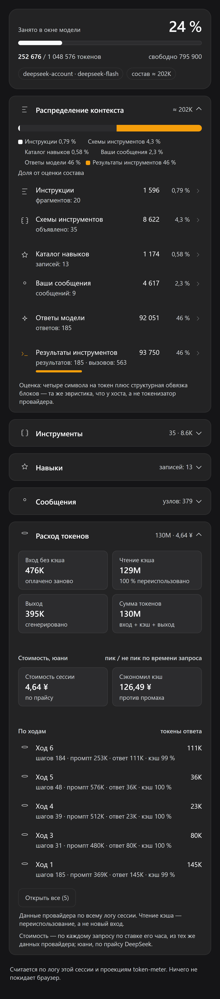

# Контекст и расход токенов

Панель правого сайдбара для DeepSeek Harness: куда уходит контекст сессии, что его съедает и сколько это стоит в юанях.

[](https://deepseek-harness.github.io/deepseek-harness/)
[](#структура-пакета)
[](#цены-в-юанях)
[](locale)

## Содержание

- [Скриншоты](#скриншоты)
- [Что показывает](#что-показывает)
- [Детализация](#детализация)
- [Цены в юанях](#цены-в-юанях)
- [Откуда цифры](#откуда-цифры)
- [Установка для человека](#установка-для-человека)
- [Установка для агента](#установка-для-агента)
- [Доступность](#доступность)
- [Структура пакета](#структура-пакета)
- [Разработка](#разработка)
- [Ограничения](#ограничения)

## Скриншоты

**Панель.** Занятость окна, распределение контекста по семи источникам, стоимость сессии в юанях и ходы. Снята на реальной сессии, тёмная тема хоста, ширина 400 px @2x.



**Детализация системного промпта.** Абзац за абзацем: токены фрагмента и его доля от промпта, свёртывание, копирование.


Обе картинки пересобираются скриптом [`tools/screenshot.mjs`](tools/screenshot.mjs): панель рендерится тем же `client.js`, а токены темы берутся из установленного приложения.

## Что показывает

| Раздел | Что внутри |
| --- | --- |
| **Занятость окна** | Размер промпта по данным провайдера против окна модели, свободный остаток, прогноз следующего запроса и оценка состава. Полоса становится янтарной после 80 % и красной после 92 %. |
| **Распределение** | Семь непересекающихся источников — инструкции, схемы инструментов, MCP, каталог навыков, ваши сообщения, ответы модели, результаты инструментов — с собственной долей, цветом и глифом. Стек-бар даёт форму, строки — числа. |
| **Инструменты** | Каждый объявленный инструмент по реальной цене: объявление плюс результаты, которые он породил. Две числовые колонки (схема и результаты), число вызовов, бейдж отложенного объявления, подытоги для встроенных и каждого MCP-сервера. |
| **Навыки** | По строке на запись каталога: сколько стоит в каждом запросе и сколько токенов вернул навык, когда его загрузили. |
| **Сообщения** | Самые тяжёлые узлы контекста, названные по инструменту («Результат · pwsh»), со сниппетом, бейджем хода и бейджем ошибки. Клик раскрывает полный текст на месте: до 20 000 символов, моноширинно, с копированием целиком. |
| **Расход токенов** | Вход без кэша, чтение кэша и запись, выход и сумма — плюс **стоимость в юанях** и экономия на кэше. |

## Детализация

Клик по строке открывает полноэкранную шторку внутри панели с кнопкой «Назад», поэтому сводка и деталь не дублируют друг друга. `Esc` закрывает шторку, фокус ставится на «Назад» и возвращается в строку-открыватель.

| Шторка | Что открывается |
| --- | --- |
| **Системный промпт** | Полный текст, карточка на абзац: токены фрагмента, доля от промпта, свёртывание. В сводке — токены, доля контекста, число фрагментов и символов, копирование всего промпта. |
| **Определения инструментов** | Все инструменты по группам с колонками схемы и результатов, включая вызовы, которых нет в объявленном списке. |
| **Каталог навыков** | Каждая запись с полным описанием, бейджем «загружен» и токенами, которые вернула загрузка. |
| **Сообщения** | До 200 самых тяжёлых узлов; раскрытие показывает полное содержимое, а не сниппет. |
| **Расход токенов** | Токены, стоимость по трём ставкам, прайс-лист модели (пик / не пик) и стоимость каждого хода. |

## Цены в юанях

Стоимость считается по каждому запросу отдельно, по ставке того часа, в который он был сделан. Цены — официальные, ¥ за 1M токенов ([прайс DeepSeek](https://api-docs.deepseek.com/quick_start/pricing), сверено 25.11.2026):

| Модель | Кэш-хит | Кэш-мисс и запись | Выход |
| --- | --- | --- | --- |
| `deepseek-flash` | ¥0,04 / ¥0,02 | ¥2,00 / ¥1,00 | ¥8,00 / ¥4,00 |
| `deepseek-v4-pro` | ¥0,30 / ¥0,15 | ¥9,00 / ¥4,50 | ¥27,00 / ¥13,50 |

Пик / не пик.

- **Пик** — Пекин, понедельник–пятница, 09:00–12:00 и 14:00–18:00 (01:00–04:00 и 06:00–10:00 UTC), полная ставка.
- **Не пик** — всё остальное время, включая выходные, вдвое дешевле.
- **Запись в кэш** тарифицируется как кэш-мисс, как и на платформе.
- **Праздники КНР** не моделируются: такой час считается по ставке пика.
- Если модели нет в прайсе, панель честно пишет, что цена неизвестна, и стоимость не показывает.

Кроме стоимости сессии панель считает **экономию на кэше** — во сколько обошёлся бы прочитанный из кэша префикс по ставке промаха.

## Откуда цифры

Всё считается в браузере из двух источников, которые сессия уже отдаёт:

1. **Окно долговременных событий** — заголовки запросов (полный список инструментов, провайдер и модель), системный промпт, сообщения поверхности, вызовы и результаты инструментов, отчёты провайдера о токенах с их временем.
2. **Проекции** `tokenUsage`, `contextPressure` и `contextBreakdown`, которые ведёт `@deepseek-ai/dsh-token-meter`.

Оценка состава использует ту же фиксированную эвристику, что и хост: четыре символа на токен плюс структурная обвязка блоков. Это приближение состава, а не токенизатор провайдера: JSON-схемы и CJK-текст считаются менее точно. Занятость окна берётся из последнего отчёта провайдера и потому авторитетна.

Расход и стоимость покрывают загруженное окно истории; когда более ранние ходы не загружены, панель об этом пишет. Ничего не покидает браузер: ни вызова модели, ни запроса наружу.

## Установка для человека

Плагин — локальный бандл DSH: ни сборки, ни зависимостей, ни сети при установке не нужно.

1. Склонировать репозиторий в рабочее пространство:

   ```bash
   git clone https://github.com/sharap0vka/dsh-plugin-context.git plugins/context-inspector
   ```

2. В DSH открыть **Плагины** → **Добавить плагин** и выбрать папку `plugins/context-inspector`.
   Приложение само добавит зависимость и строку бандла в профиль, править `package.json` профиля руками не нужно.

3. Если DSH попросит перезапуск — перезапустить. Если строка `@local/context-inspector` в списке плагинов выключена — включить её.

4. Открыть панель: правый сайдбар → **+** в конце полосы вкладок → карточка **Контекст** (глиф диаграммы). Панель докируется и делит колонку так же, как «Файлы» или «Терминал».

5. Если вкладки нет — обновить окно (`Ctrl+R` / `F5`): клиентский бандл кешируется до перезагрузки страницы.

Настроек у плагина нет: ни схемы `Config`, ни ключей, ни разрешений. Чтобы отключить — выключить строку плагина в **Плагинах**; панель исчезнет, на сессии это никак не влияет.

## Установка для агента

Инструкция для агента, у которого есть инструмент `plugin_manager` (DSH-агент в этом же профиле). Копируется целиком.

```text
Задача: установить пользовательский бандл DSH @local/context-inspector из локальной папки.

1. Склонировать репозиторий в рабочее пространство:
   git clone https://github.com/sharap0vka/dsh-plugin-context.git plugins/context-inspector

2. Проверить манифест, а не доверять имени папки:
   - package.json → dsh.bundle.patch = "./cordis.patch.yml"
   - cordis.patch.yml вставляет строку: id: context-inspector, name: '@local/context-inspector'
   Установка зависимостей и сборка не нужны.

3. Установить бандл абсолютным путём к папке:
   plugin_manager { "action": "install_bundle", "target": "<абсолютный путь к plugins/context-inspector>" }
   Не писать руками package.json профиля, не править его cordis.patch.yml,
   не запускать pnpm в каталоге профиля: это делает install_bundle.

4. Прочитать результат: application = applied | restart-required | failed.
   restart-required — попросить пользователя перезапустить DSH; failed — диагностировать, не «пробовать ещё раз».

5. Проверить регистрацию без перезапуска страницы (Approval-free):
   cordis_inspect_query { platform: "client", provider: "Slots", method: "listSubTree", input: { root: "sidebar.right.pane.tab" } }
   Ожидается occupant с key "@local/context-inspector".

6. Сказать пользователю: правый сайдбар → «+» → карточка «Контекст».
   Если панель не появилась — обновить окно (F5): клиентский бандл кешируется.

Если инструмента plugin_manager нет — не менять пресет и не писать в профиль:
сообщить пользователю путь к папке и что установка делается через
«Плагины» → «Добавить плагин».

Проверка без браузера (из корня папки плагина):
   node tools/verify-pricing.mjs        → PRICING: PASS
   node tools/render-smoke.mjs <session.v4.jsonl.zstd>   → открываются все пять шторок
```

Установка требует подтверждения пользователя на действие `install_bundle`; агент не должен обходить его сам.

## Доступность

- Каждая интерактивная строка — настоящий `<button>`: Enter, Space и порядок обхода работают без ручных обработчиков.
- Шторка — диалог с подписью: фокус переходит на «Назад», Tab заперт внутри, `Esc` закрывает, фокус возвращается в строку-открыватель.
- Копирование объявляется через вежливый live-region; полоса занятости — `progressbar` с `aria-valuenow` и произносимым значением.
- Числа и проценты форматирует `Intl` для активной локали; панель уважает `prefers-reduced-motion` и увеличивает зоны нажатия на грубом указателе.
- Длинные списки используют `content-visibility`, строки вне экрана не стоят ни вёрстки, ни отрисовки.

## Структура пакета

```text
dsh-plugin-context/
├── client.js            # панель: фолд лога, вёрстка, цены, локали
├── index.js             # хост-половина (пустая: сервисов не нужно)
├── cordis.patch.yml     # строка, которую бандл вставляет в профиль
├── package.json         # манифест: dsh.bundle.patch + dsh.client
├── locale/{en,ru}.json  # название и описание в списке плагинов
├── icon.svg             # иконка вкладки и строки плагина
├── docs/*.png           # скриншоты для README
└── tools/               # проверки и пересборка скриншотов
```

Патч вставляет ровно одну строку — `@local/context-inspector`; клиентская половина регистрирует вкладку `context-inspector` и компонент в слоте `sidebar.right.pane.tab`.

## Разработка

Панель не требует сборки: `client.js` — готовый клиентский модуль, который загружает лоадер плагинов.

```bash
# прогон на реальном логе: карточки, строки, все пять шторок и раскрытие содержимого
node tools/render-smoke.mjs <session.v4.jsonl.zstd>

# тарифы: окна пика, обе таблицы, алиасы моделей, формат денег
node tools/verify-pricing.mjs

# пересобрать docs/panel.png и docs/system-prompt.png headless-браузером
node tools/screenshot.mjs <session.v4.jsonl.zstd>
```

Скрипты понимают оба раскладки: запуск из папки плагина и из рабочего пространства, где они лежат в `tools/`.

## Ограничения

- Стоимость считается по ставке часа запроса, но **без календаря праздников КНР**.
- Прайс зашит в `client.js`: при изменении цен его нужно обновить (`CNY_PER_MILLION`).
- Разбивка по сообщениям и инструментам покрывает загруженное окно истории; суммы расхода — весь лог.
- Модели без опубликованной цены стоимость не считают.
- Стили — только на токенах темы хоста, поэтому панель следует и светлой, и тёмной теме; своих цветов, шрифтов и картинок в интерфейсе нет.
